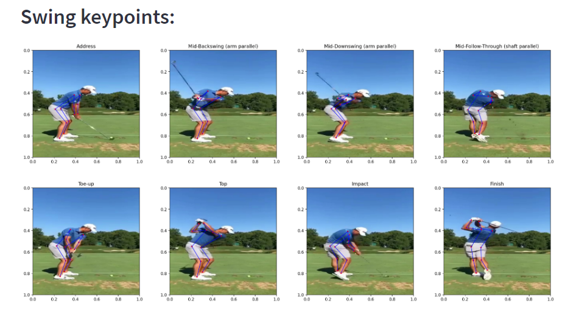
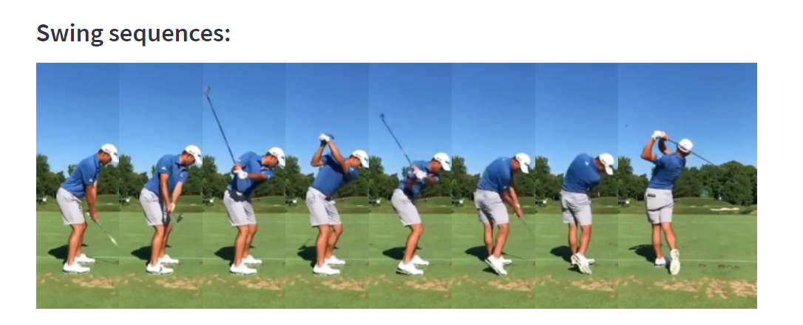
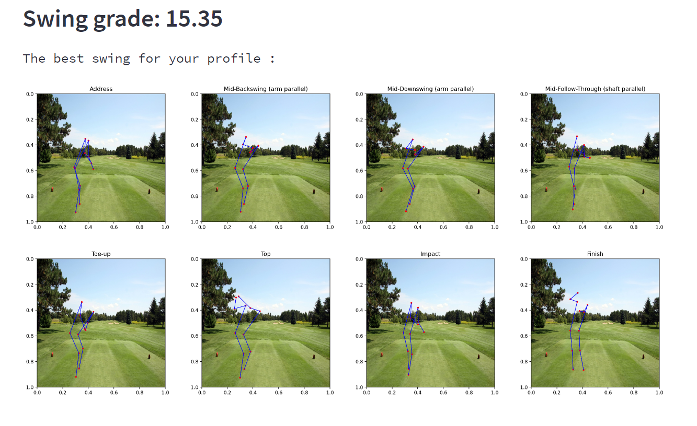
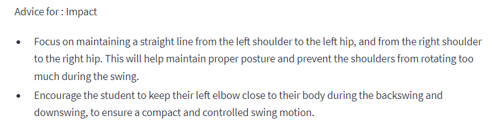

# AI golf swing analysis

### This project is a golf swing analysis tool that analyzes the user swing through swing sequencing and human pose estimation. 

This is a fork from the [GolfDB: A Video Database for Golf Swing Sequencing](https://github.com/wmcnally/golfdb/tree/master) and [Swing-Analysis-System](https://github.com/Cdavison-development/Swing-Analysis-System)

This project is ready to use and provide a friendly UI to drag and drop your swing video and appreciate analyse and feedback.



## Architecture 

The application is run with the `streamlit` library on http://localhost:8501/

The pipeline of the analyse :

- **_Upload your swing_** : Insert your video in the application

- **_Swing sequencing_** : PyTorch implemention of the SwingNet baseline model (average PCE of 71.5%) to extract 8 significants sequences of your swing

    - Address
    - Toe-up
    - Mid-Backswing (arm parallel)
    - Top
    - Mid-Downswing (arm parallel)
    - Impact
    - Mid-Follow-Through (shaft parallel)
    - Finish



- **_Swing keypoints_** : PyTorch implemention of [MediaPipe](https://developers.google.com/mediapipe/solutions/vision/pose_landmarker) model to extract human skeleton keypoints from each swing sequence

- **_Professional swing comparison_** : Comparison of your swing with a database of 500 professionals swing (only down the line view). We determine which swings are the closest to yours, using the Euclidean distance and the Cosine similarity. We will be able to grade you swing /20

- **_Best swing with recommandations_** : We can now display the best swing for your profile using the combinaison of the best pros keypoints. 

- **_Recommendations_** : Using ChatGPT API 3.5 turbo model, the application provide  custom advices for refining your joints alignment, ensuring smooth transitions, and maintaining posture.





## Installation

- Developped the project with Python 3.9.13, and didn't test the others versions.

[Download Python 3.9.13](https://www.python.org/downloads/release/python-3913/)

- Download [CUDA Toolkit](https://developer.nvidia.com/cuda-downloads) for your computer

- Clone the repository :

```
git clone https://github.com/VictorRios-hub/AI_swing_analysis.git
```

- Requirements to run the scripts can be found in the requirements.txt file :

```pip install -r requirements.txt``` 

- Install torch, torchvision and CUDA for your device

Check your ***CUDA*** version using ```nvcc --version``` and go [here](https://pytorch.org/get-started/locally/) to check your appropriate torch version

Then, install the correct version using : ```pip3 install torch torchvision --index-url YOUR_VERSION``` 

If you followed the previous steps, your installation should be the same as mine : ```pip3 install torch torchvision --index-url https://download.pytorch.org/whl/cu121```

- Modify the OpenAI API key in [FeedBack.py](System_folder/FeedBack.py)
Make sure to generate your API key on https://platform.openai.com/api-keys and add some credits to issue requests

```python
openai.api_key = "Your API key"
``` 

## Getting started

Since you have everything installed, you can start the application with a double click on [GolfSwing.exe]() or run [app.py](app.py) with the command ```python3 app.py```

You can also run the application using the command ```streamlit run index.py```

Feel free to add this app shortcut for your desktop ! :grin:

### Prompt fine-tuning 

Feel free to make changes in the OpenAI prompt in [FeedBack.py](System_folder/FeedBack.py)

```python
prompt = (f"As a professional golf swing master, you assist golf students in refining their technique. Focus on the {keypoint_description} (keypoint {keypoint}), comparing amateur ({amateur_coords}) and professional ({pro_coords}) data coordinates. Differences in x, y, z: {diff_x}, {diff_y}, {diff_z}."
    f"First advice: Analyze disparities concerning {keypoint_descriptions} and {keypoint_lists} in amateur and professional data. Amateur data coordinates ({data1}), professional data coordinates ({data2}). "
    f"Provide two specific, succinct, rule-based advices for refining {keypoint_descriptions} alignment, ensuring smooth transitions, and maintaining posture. Use bullet points to list the advices."
    f"Your expertise guides the user to an improved golf swing in real life, don't use keypoint number in your answer. Before output, ensure adherence to rules for optimal accuracy.")
```

### Training and evaluate

In order to train the SwingNet model with your own data for swing segmentation please refer to the [GolfDB repository](https://github.com/wmcnally/golfdb/tree/master)

In order to modify keypoints model and comparison algorithms please modify respectively [AmateurKeypointToJson.py](System_folder\Pose_estimation\AmateurKeypointToJson.py) and [JsonComparison.py](System_folder\Pose_estimation\JsonComparison.py)

If you want to use your own dataset, modify the files in `System_folder/golfdb/data` and follow the steps in the [Swing-Analysis-System repository](https://github.com/Cdavison-development/Swing-Analysis-System)

## Citations :

```
@InProceedings{McNally_2019_CVPR_Workshops,
author = {McNally, William and Vats, Kanav and Pinto, Tyler and Dulhanty, Chris and McPhee, John and Wong, Alexander},
title = {GolfDB: A Video Database for Golf Swing Sequencing},
booktitle = {The IEEE Conference on Computer Vision and Pattern Recognition (CVPR) Workshops},
month = {June},
year = {2019}
}
```
### License :

The code in this repository is licensed under a [Creative Commons Attribution-NonCommercial 4.0 International License](https://creativecommons.org/licenses/by-nc/4.0/). 
